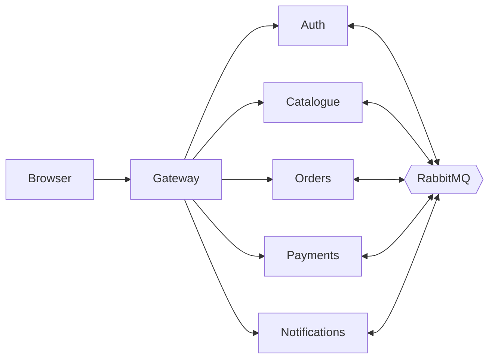
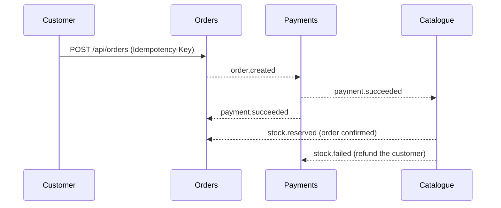

# Haat: multi-vendor marketplace

Many independent sellers, one cart. A customer buys from several sellers in a single checkout, the order is split into one parcel per seller, the platform keeps a commission, and each seller is paid out after delivery.

The backend is a set of small Node.js services that talk to each other through RabbitMQ events. It is built to survive failures: if a service goes down, orders wait in the queue and finish when it comes back.

<!--
Add your screenshots here after you save them in a screenshots/ folder, for example:


-->

## What it does

**Customer**
- Browse products with live search, sorting, categories and a saved list
- One cart across many sellers, one checkout
- Order page that updates by itself: Placed, Packing, Shipped, Delivered
- Return a delivered item and get a refund

**Seller**
- Apply with store details, wait for admin approval
- Manage products, stock and images
- Fulfil orders (ship, deliver, cancel)
- Earnings split into *held*, *ready for payout* and *paid*, with a 7 day chart

**Admin**
- Approve or suspend sellers, set a commission % per seller, delete suspended stores
- Platform numbers: sales, commission, refunds, money held in escrow
- Run settlement: every seller is paid sales minus commission minus refunds
- Live system health panel: which services are up and how many events are waiting in each queue

## Architecture



| Service | Own database | Responsibility |
|---|---|---|
| gateway | none | serves the site, checks the JWT, rate limit, correlation id, forwards requests |
| auth | auth_db | register, login, roles (customer, vendor, admin) |
| catalogue | catalogue_db | vendor onboarding and approval, products, search, stock reservation |
| orders | orders_db | checkout, idempotency key, per-seller sub-orders, fulfilment, returns |
| payments | payments_db | payment capture, commission split, escrow ledger, payouts |
| notifications | notifications_db | turns events into alerts (email is logged to the console) |

No service reads another service's database. They exchange events on a RabbitMQ topic exchange, plus one small internal HTTP call (orders asks catalogue for real prices).

## How an order works (saga)



- If the card is declined, the order is marked failed and no stock is taken.
- If stock runs out after payment, the payments service refunds automatically (compensating action) and the order is cancelled.

## Design decisions

- **Idempotency key** on `POST /api/orders` with a unique index on customer + key, so a double click or a retry never creates two orders.
- **Outbox pattern**: each service saves events in its own `outboxevents` collection first, and a relay publishes them. A broker outage does not lose events.
- **Idempotent consumers**: handled event ids are stored (`processedevents`), so duplicate or replayed events are skipped. Payment handling can also resume safely after a crash.
- **Escrow ledger**: a sale is *held* until delivery, then *available*, then *paid*.
- **Payout maths**: `net = sales - commission - refunds + commission returned on refunds`. If a seller owes more than they earned, the balance carries to the next run. Running payouts twice never pays twice.
- **Commission is stored per order**, so changing a seller's commission only affects new orders.
- **Prices come from the server** at checkout, never from the browser.

## Tech stack

Node.js, Express, MongoDB (Mongoose), RabbitMQ (amqplib), JWT, bcrypt, Docker Compose. Frontend: plain JavaScript single-page app, no build step.

## Run it

You only need Docker.

```bash
docker compose up -d --build
```

Open http://localhost:8080 and wait about 30 seconds on the first start. RabbitMQ dashboard: http://localhost:15672 (guest / guest).

**Demo logins** (for local use only, change `.env` before putting this anywhere public):

| Role | Email | Password |
|---|---|---|
| Admin | admin@haat.local | admin123 |
| Customer | customer@haat.demo | demo123 |
| Sellers | seller1@haat.demo, seller2@haat.demo, seller3@haat.demo | demo123 |

The customer and seller accounts appear after the admin clicks **Load demo data** on the Admin page.

**A 2 minute demo**
1. Log in as admin, click **Load demo data**, log out.
2. Log in as the customer, add products from two different sellers, pay.
3. Watch **My orders** update. Log in as a seller, mark the order shipped, then delivered.
4. As admin, click **Run payouts now**.
5. Resilience: run `docker compose stop payments`, place an order, watch the queue grow in the admin health panel, then run `docker compose start payments` and watch it finish.

## Automated test

With the project running:

```bash
docker compose --profile test run --rm tests
```

It creates its own sellers and customers and checks: order splitting, idempotency, declined card, two people buying the last item (saga and refund), shipping rules, permissions, commission maths, payouts (and no double payout) and a return after payout. Every check prints PASS or FAIL. To clean up after a crashed run:

```bash
docker compose exec -T mongo mongosh --quiet < scripts/clean-test-data.js
```

## Known limits and next steps

- Payments are simulated. Real Stripe Connect or Razorpay Route is not connected.
- KYC upload takes document names only. S3 upload is not built.
- Payout settlement is a button, not a scheduled job.
- The order and its event are two separate writes. A MongoDB replica set with a transaction would make this atomic.
- No HTTPS, reverse proxy or CI/CD yet.
- The frontend is plain JavaScript. A React and TypeScript version is planned.
- Only one end-to-end test script exists, there are no unit tests yet.
